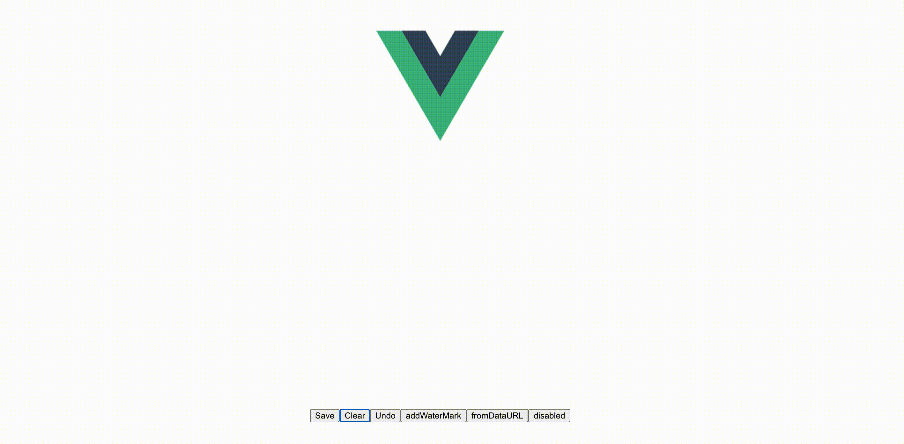

<div align="center">
  <h1>✍️ Vue3 Signature</h1>
  <p>一个流畅优雅的 Vue 3 电子签名组件</p>
  <p><strong>基于 <a href="https://github.com/szimek/signature_pad">signature_pad</a></strong> - 最流行的 HTML5 Canvas 签名库</p>
  
  [](https://www.npmjs.com/package/vue3-signature)
  [](https://www.npmjs.com/package/vue3-signature)
  [](https://github.com/WangShayne/vue3-signature/blob/master/LICENSE)
  [](https://vuejs.org/)
  [](https://github.com/szimek/signature_pad)
  
  [🎮 在线体验](#-在线体验) • 
  [✨ 特性](#-特性) • 
  [🚀 快速开始](#-快速开始) • 
  [📖 文档](#-文档) • 
  [💡 示例](#-示例)
  
  <p>
    <a href="./README.md">English</a> | 
    <a href="./README.zh-CN.md">简体中文</a>
  </p>
</div>

---

## 🎮 在线体验

无需安装，直接在浏览器中体验 Vue3 Signature：

**👉 [GitHub Pages 在线演示](https://wangshayne.github.io/vue3-signature/)** - 在浏览器中试用所有功能！

> 演示展示了组件的所有功能，包括绘制、保存、撤销、水印等。

### 🚀 部署你自己的演示

想要部署自己的演示吗？查看我们的[部署指南](./DEPLOY.zh-CN.md)了解如何部署到 GitHub Pages 的详细说明。

### 📁 新功能：图片导入

在线演示现在支持**导入图片**功能：
- 📁 上传本地图片文件
- 🔗 从URL加载图片
- 🖼️ 一键尝试示例图片

非常适合编辑现有签名、添加标注或使用模板！

## ✨ 特性

### 🎯 核心技术

基于 **[signature_pad](https://github.com/szimek/signature_pad)** 构建 - 这是由 Szymon Nowak 开发的行业标准 HTML5 Canvas 平滑签名绘制库，拥有 **13k+ GitHub 星标**，可靠性经过验证。

### ⚡ 主要特性

- 📱 **触摸和鼠标支持** - 在移动设备和桌面设备上无缝工作
- 🎨 **可自定义** - 完全可定制的画笔颜色、背景和签名样式
- 💾 **多种导出格式** - 导出签名为 PNG、JPEG 或 SVG 格式
- 🔄 **撤销支持** - 简单的撤销功能，提供更好的用户体验
- 🖼️ **水印支持** - 为签名添加自定义水印
- 🚫 **禁用模式** - 在可编辑和只读状态之间切换
- 📐 **响应式** - 自动适应容器大小
- 🎯 **TypeScript 支持** - 包含完整的 TypeScript 类型定义
- ⚡ **轻量级** - 小巧的包体积，无不必要的依赖
- 🌍 **跨平台** - 适用于所有现代浏览器和移动设备



## 🚀 快速开始

### 安装

```bash
# 使用 npm
npm install vue3-signature

# 使用 yarn
yarn add vue3-signature

# 使用 pnpm
pnpm add vue3-signature
```

### 基本使用

**步骤 1：** 全局注册组件

```javascript
// main.js
import { createApp } from "vue";
import Vue3Signature from "vue3-signature";
import App from "./App.vue";

createApp(App).use(Vue3Signature).mount("#app");
```

**步骤 2：** 在组件中使用

```vue
<template>
  <div>
    <Vue3Signature
      ref="signature"
      :sigOption="options"
      :w="'800px'"
      :h="'400px'"
    />

    <div class="buttons">
      <button @click="save">保存为 PNG</button>
      <button @click="clear">清空</button>
      <button @click="undo">撤销</button>
    </div>
  </div>
</template>

<script setup>
import { ref, reactive } from "vue";

const signature = ref(null);
const options = reactive({
  penColor: "rgb(0, 0, 0)",
  backgroundColor: "rgb(255, 255, 255)",
});

const save = () => {
  const png = signature.value.save();
  console.log(png); // base64 data URL
};

const clear = () => {
  signature.value.clear();
};

const undo = () => {
  signature.value.undo();
};
</script>
```

## 📖 文档

### 属性

| 属性            | 类型      | 默认值                                                            | 描述                                  |
| --------------- | --------- | ----------------------------------------------------------------- | ------------------------------------- |
| `sigOption`     | `Object`  | `{penColor: "rgb(0, 0, 0)", backgroundColor: "rgb(255,255,255)"}` | 签名板选项，包括画笔颜色和背景颜色    |
| `w`             | `String`  | `"100%"`                                                          | 签名板宽度（例如 `"100%"`、`"500px"`）|
| `h`             | `String`  | `"100%"`                                                          | 签名板高度（例如 `"100%"`、`"300px"`）|
| `clearOnResize` | `Boolean` | `false`                                                           | 窗口调整大小时是否清空画布            |
| `waterMark`     | `Object`  | `{}`                                                              | 水印配置（参见[水印选项](#水印选项)）|
| `disabled`      | `Boolean` | `false`                                                           | 禁用/启用签名输入                     |
| `defaultUrl`    | `String`  | `""`                                                              | 要在画布上显示的默认图像 URL          |

> 💡 `sigOption` 支持 [`signature_pad` 提供的全部参数](https://github.com/szimek/signature_pad#options)。组件会深度监听该对象，自动重建签名板并尽量保留当前笔画。

### 方法

通过组件 ref 可以访问 `signature_pad` 的所有公开 API：

| 方法                              | 参数                                                                            | 返回值          | 描述                                                                                                   |
| --------------------------------- | ------------------------------------------------------------------------------- | --------------- | ------------------------------------------------------------------------------------------------------ |
| `save(format?, encoderOptions?)`  | 同 `toDataURL`                                                                  | `string`        | `toDataURL` 的兼容别名，方便旧版本升级。                                                               |
| `toDataURL(format?, encoderOptions?)` | 与 `signature_pad#toDataURL` 完全一致                                              | `string`        | 按 PNG/JPEG/SVG 导出签名，支持传入编码参数。                                                           |
| `toSVG(options?)`                 | `options?: ToSVGOptions`                                                        | `string`        | 输出 SVG 字符串，可选包含背景色或 `fromDataURL` 导入的图片。                                           |
| `clear()`                         | -                                                                               | `void`          | 使用当前背景色清空画布。                                                                               |
| `redraw()`                        | -                                                                               | `void`          | 重新渲染当前保存的笔画/导入的图片。                                                                   |
| `isEmpty()`                       | -                                                                               | `boolean`       | 判断画布是否为空。                                                                                     |
| `undo(steps = 1)`                 | `steps?: number`                                                                | `void`          | 撤销最近的若干笔画。                                                                                   |
| `toData()`                        | -                                                                               | `PointGroup[]`  | 获取 `signature_pad` 的原始笔画数据。                                                                  |
| `fromData(pointGroups, options?)` | `pointGroups: PointGroup[]`, `options?: FromDataOptions`                        | `void`          | 根据原始笔画数据绘制，可控制是否清空画布。                                                             |
| `fromDataURL(url, options?)`      | `url: string`, `options?: FromDataUrlOptions`                                   | `Promise<void>` | 与 `signature_pad#fromDataURL` 完全一致的导入能力。                                                     |
| `addWaterMark(options)`           | `options: WaterMarkOption`                                                      | `void`          | 便捷水印工具，保留原有功能。                                                                           |
| `trim(options?)`                  | `options?: TrimOptions`                                                         | `TrimResult \| null` | 克隆画布、裁剪留白并返回离屏结果，不会影响用户看到的内容。                                   |
| `toTrimmedDataURL(format?, encoderOptions?)` | `format?: string`, `encoderOptions?: number`                           | `string`        | 仅返回裁剪后的 data URL，内部复用 `trim`。                                                               |
| `enable()` / `disable()`          | -                                                                               | `void`          | 直接调用底层的 `on()`/`off()`，用于切换编辑状态。                                                       |
| `addEventListener(...)`           | 与 `EventTarget#addEventListener` 相同                                          | `void`          | 绑定 `signature_pad` 的底层事件。                                                                      |
| `removeEventListener(...)`        | 与 `EventTarget#removeEventListener` 相同                                       | `void`          | 移除事件监听。                                                                                         |
| `getInstance()`                   | -                                                                               | `SignaturePad?` | 获取底层 `SignaturePad` 实例，方便直接访问所有属性/方法。                                             |

### 事件

| 事件                | 载荷              | 说明                                             |
| ------------------- | ----------------- | ------------------------------------------------ |
| `ready`             | `SignaturePad`    | 组件初始化完成并调整完大小后触发。               |
| `begin` / `end`     | `void`            | 兼容旧版本，与 `beginStroke` / `endStroke` 同时触发。 |
| `beginStroke`       | `SignatureEvent`  | 笔画开始前的详细信息。要取消绘制，请在组件实例上使用 `addEventListener('beginStroke', event => event.preventDefault())`。 |
| `beforeUpdateStroke`| `SignatureEvent`  | 笔画更新前回调。                                 |
| `afterUpdateStroke` | `SignatureEvent`  | 笔画更新后回调。                                 |
| `endStroke`         | `SignatureEvent`  | 笔画结束时触发。                                 |

### 签名选项

```typescript
import type { Options as SignaturePadOptions } from "signature_pad";

type SigOption = SignaturePadOptions;

// 你可以传入 signature_pad 支持的所有配置，例如：
// dotSize?: number;
// minWidth?: number;
// maxWidth?: number;
// minDistance?: number;
// throttle?: number;
// velocityFilterWeight?: number;
// penColor?: string;
// backgroundColor?: string;
// compositeOperation?: GlobalCompositeOperation;
// canvasContextOptions?: CanvasRenderingContext2DSettings;
```

### 水印选项

```typescript
interface WaterMarkOption {
  text?: string; // 水印文本（默认：""）
  font?: string; // 字体样式（默认："20px sans-serif"）
  style?: string; // 样式类型："all" | "stroke" | "fill"（默认："fill"）
  fillStyle?: string; // 填充颜色（默认："#333"）
  strokeStyle?: string; // 描边颜色（默认："#333"）
  x?: number; // 填充文本 X 位置（默认：20）
  y?: number; // 填充文本 Y 位置（默认：20）
  sx?: number; // 描边文本 X 位置（默认：40）
  sy?: number; // 描边文本 Y 位置（默认：40）
}
```

### 裁剪结果与选项

```typescript
interface TrimResult {
  canvas: HTMLCanvasElement;            // 离屏画布（已裁剪）
  dataUrl: string;                     // 方便直接使用的裁剪后 data URL
  bounds: { x: number; y: number; width: number; height: number }; // 裁剪区域（像素）
}

interface TrimOptions {
  format?: string;         // 传给 canvas.toDataURL 的格式
  encoderOptions?: number; // JPEG/WebP 质量
  backgroundColor?: string;// 覆盖用于检测留白的背景色
}
```

## 💡 示例

### 保存为不同格式

```vue
<template>
  <Vue3Signature ref="signature" :w="'800px'" :h="'400px'" />

  <button @click="saveAsPNG">保存为 PNG</button>
  <button @click="saveAsJPEG">保存为 JPEG</button>
  <button @click="saveAsSVG">保存为 SVG</button>
</template>

<script setup>
import { ref } from "vue";

const signature = ref(null);

const saveAsPNG = () => {
  const dataUrl = signature.value.save(); // 或 save('image/png')
  downloadImage(dataUrl, "signature.png");
};

const saveAsJPEG = () => {
  const dataUrl = signature.value.save("image/jpeg");
  downloadImage(dataUrl, "signature.jpg");
};

const saveAsSVG = () => {
  const dataUrl = signature.value.save("image/svg+xml");
  downloadImage(dataUrl, "signature.svg");
};

const downloadImage = (dataUrl, filename) => {
  const link = document.createElement("a");
  link.href = dataUrl;
  link.download = filename;
  link.click();
};
</script>
```

### 自定义画笔颜色和样式

```vue
<template>
  <div>
    <div class="color-picker">
      <button @click="setPenColor('#000000')">黑色</button>
      <button @click="setPenColor('#0000ff')">蓝色</button>
      <button @click="setPenColor('#ff0000')">红色</button>
      <button @click="setPenColor('#00ff00')">绿色</button>
    </div>

    <Vue3Signature
      ref="signature"
      :sigOption="options"
      :w="'100%'"
      :h="'400px'"
    />
  </div>
</template>

<script setup>
import { ref, reactive } from "vue";

const signature = ref(null);
const options = reactive({
  penColor: "rgb(0, 0, 0)",
  backgroundColor: "rgb(255, 255, 255)",
  minWidth: 1,
  maxWidth: 3,
});

const setPenColor = (color) => {
  options.penColor = color;
};
</script>

<style scoped>
.color-picker {
  margin-bottom: 10px;
}

.color-picker button {
  margin-right: 10px;
  padding: 8px 16px;
  border-radius: 4px;
  border: 1px solid #ddd;
  cursor: pointer;
}
</style>
```

### 添加水印

```vue
<template>
  <Vue3Signature ref="signature" :w="'800px'" :h="'400px'" />
  <button @click="addWatermark">添加水印</button>
</template>

<script setup>
import { ref } from "vue";

const signature = ref(null);

const addWatermark = () => {
  signature.value.addWaterMark({
    text: "机密",
    font: "30px Arial",
    style: "all",
    fillStyle: "rgba(255, 0, 0, 0.3)",
    strokeStyle: "rgba(255, 0, 0, 0.5)",
    x: 100,
    y: 200,
    sx: 102,
    sy: 202,
  });
};
</script>
```

### 禁用模式（只读）

```vue
<template>
  <div>
    <Vue3Signature
      ref="signature"
      :disabled="isDisabled"
      :w="'800px'"
      :h="'400px'"
    />

    <button @click="toggleDisabled">
      {{ isDisabled ? "启用" : "禁用" }} 编辑
    </button>
  </div>
</template>

<script setup>
import { ref } from "vue";

const signature = ref(null);
const isDisabled = ref(false);

const toggleDisabled = () => {
  isDisabled.value = !isDisabled.value;
};
</script>
```

### 从 Data URL 加载

```vue
<template>
  <div>
    <Vue3Signature ref="signature" :w="'800px'" :h="'400px'" />

    <button @click="loadSignature">加载已保存的签名</button>
    <button @click="saveSignature">保存当前签名</button>
  </div>
</template>

<script setup>
import { ref } from "vue";

const signature = ref(null);
const savedSignature = ref("");

const saveSignature = () => {
  savedSignature.value = signature.value.save();
  alert("签名已保存！");
};

const loadSignature = () => {
  if (savedSignature.value) {
    signature.value.fromDataURL(savedSignature.value);
  } else {
    alert("未找到已保存的签名！");
  }
};
</script>
```

### 响应式设计

```vue
<template>
  <div class="signature-container">
    <Vue3Signature
      ref="signature"
      :w="'100%'"
      :h="'100%'"
      :clearOnResize="false"
    />
  </div>
</template>

<script setup>
import { ref } from "vue";

const signature = ref(null);
</script>

<style scoped>
.signature-container {
  width: 100%;
  height: 400px;
  max-width: 800px;
  margin: 0 auto;
  border: 2px solid #e0e0e0;
  border-radius: 8px;
  overflow: hidden;
}

@media (max-width: 768px) {
  .signature-container {
    height: 300px;
  }
}
</style>
```

### 移除签名周围的留白

```vue
<template>
  <Vue3Signature ref="signature" :w="'600px'" :h="'250px'" @end="trim" />
  
</template>

<script setup>
import { ref } from "vue";

const signature = ref(null);
const trimmed = ref("");

const trim = () => {
  const result = signature.value.trim();
  trimmed.value = result?.dataUrl ?? "";
};
</script>
```

该功能基于 [issue #49 中的裁剪方案](https://github.com/szimek/signature_pad/issues/49#issuecomment-260976909)：组件复制当前画布，计算笔迹的最小包围盒并裁剪，只返回裁剪后的结果，不会修改用户正在编辑的画布。

## 🔧 高级用法

### 完整功能示例

```vue
<template>
  <div class="signature-app">
    <h2>电子签名板</h2>

    <div class="controls">
      <div class="control-group">
        <label>画笔颜色：</label>
        <input type="color" v-model="options.penColor" />
      </div>

      <div class="control-group">
        <label>背景颜色：</label>
        <input type="color" v-model="options.backgroundColor" />
      </div>

      <div class="control-group">
        <label>
          <input type="checkbox" v-model="isDisabled" />
          只读模式
        </label>
      </div>
    </div>

    <Vue3Signature
      ref="signature"
      :sigOption="options"
      :disabled="isDisabled"
      :w="'100%'"
      :h="'400px'"
      class="signature-pad"
    />

    <div class="button-group">
      <button @click="save('image/png')" class="btn btn-primary">
        💾 保存 PNG
      </button>
      <button @click="save('image/jpeg')" class="btn btn-primary">
        💾 保存 JPEG
      </button>
      <button @click="clear" class="btn btn-danger">🗑️ 清空</button>
      <button @click="undo" class="btn btn-secondary">↩️ 撤销</button>
      <button @click="addWatermark" class="btn btn-secondary">
        🔖 添加水印
      </button>
    </div>

    <div v-if="preview" class="preview">
      <h3>预览：</h3>
      
    </div>
  </div>
</template>

<script setup>
import { ref, reactive } from "vue";

const signature = ref(null);
const preview = ref("");
const isDisabled = ref(false);

const options = reactive({
  penColor: "rgb(0, 0, 0)",
  backgroundColor: "rgb(255, 255, 255)",
});

const save = (format) => {
  if (signature.value.isEmpty()) {
    alert("请先提供签名。");
    return;
  }

  const dataUrl = signature.value.save(format);
  preview.value = dataUrl;

  // 下载图片
  const link = document.createElement("a");
  const extension = format === "image/jpeg" ? "jpg" : "png";
  link.download = `signature.${extension}`;
  link.href = dataUrl;
  link.click();
};

const clear = () => {
  signature.value.clear();
  preview.value = "";
};

const undo = () => {
  signature.value.undo();
};

const addWatermark = () => {
  signature.value.addWaterMark({
    text: new Date().toLocaleDateString(),
    font: "16px Arial",
    fillStyle: "rgba(0, 0, 0, 0.3)",
    x: 10,
    y: 30,
  });
};
</script>

<style scoped>
.signature-app {
  max-width: 900px;
  margin: 0 auto;
  padding: 20px;
}

.controls {
  display: flex;
  gap: 20px;
  margin-bottom: 20px;
  flex-wrap: wrap;
}

.control-group {
  display: flex;
  align-items: center;
  gap: 10px;
}

.signature-pad {
  border: 2px solid #e0e0e0;
  border-radius: 8px;
  box-shadow: 0 2px 8px rgba(0, 0, 0, 0.1);
}

.button-group {
  display: flex;
  gap: 10px;
  margin-top: 20px;
  flex-wrap: wrap;
}

.btn {
  padding: 10px 20px;
  border: none;
  border-radius: 4px;
  cursor: pointer;
  font-size: 14px;
  transition: all 0.3s ease;
}

.btn-primary {
  background-color: #4caf50;
  color: white;
}

.btn-primary:hover {
  background-color: #45a049;
}

.btn-danger {
  background-color: #f44336;
  color: white;
}

.btn-danger:hover {
  background-color: #da190b;
}

.btn-secondary {
  background-color: #2196f3;
  color: white;
}

.btn-secondary:hover {
  background-color: #0b7dda;
}

.preview {
  margin-top: 30px;
  padding: 20px;
  background: #f5f5f5;
  border-radius: 8px;
}

.preview img {
  max-width: 100%;
  border: 1px solid #ddd;
  border-radius: 4px;
}
</style>
```

## 🌐 浏览器支持

Vue3 Signature 适用于所有现代浏览器：

- ✅ Chrome（最新版）
- ✅ Firefox（最新版）
- ✅ Safari（最新版）
- ✅ Edge（最新版）
- ✅ Opera（最新版）
- ✅ 移动浏览器（iOS Safari、Chrome Mobile）

## 🤝 贡献

欢迎贡献！请随时提交 Pull Request。

1. Fork 本仓库
2. 创建你的特性分支（`git checkout -b feature/AmazingFeature`）
3. 提交你的更改（`git commit -m 'Add some AmazingFeature'`）
4. 推送到分支（`git push origin feature/AmazingFeature`）
5. 打开一个 Pull Request

## 📝 更新日志

详细更新日志请查看 [Releases](https://github.com/WangShayne/vue3-signature/releases)。

## 🙏 致谢与依赖

### 核心依赖

这个 Vue 3 组件是对 **[signature_pad](https://github.com/szimek/signature_pad)** 的封装 - 最流行和可靠的 HTML5 Canvas 签名库。

**为什么选择 signature_pad？**
- ⭐ **13,000+ GitHub 星标** - 受到全球数千名开发者的信赖
- 🏆 **行业标准** - 在无数生产应用中使用
- 🎨 **流畅绘制** - 采用先进的贝塞尔曲线插值算法，实现自然的签名效果
- 📱 **触摸优化** - 完美支持触摸屏和手写笔输入
- 🔧 **维护良好** - 活跃的开发和定期更新
- 📦 **轻量级** - 最小的体积，最大的功能

**库信息：**
- 作者：[Szymon Nowak](https://github.com/szimek)
- 仓库：[github.com/szimek/signature_pad](https://github.com/szimek/signature_pad)
- 许可证：MIT
- 当前版本：5.1.1

通过使用 Vue3 Signature，你可以获得 signature_pad 的全部功能，同时享受 Vue 3 组合式 API 的简洁性。

## 开发与验证

使用 Node.js 22 和 npm，以 `package-lock.json` 作为维护的锁文件。

```sh
npm ci
npm test
npm run build
npm run test:types
npm run build:demo
```

测试挂载真实 Vue 组件和 `signature_pad`，通过 DOM 事件与原生 Canvas 渲染验证行为。`npm pack` 和 `npm publish` 会先执行测试，再生成 JavaScript 和类型声明。Vue 作为 peer dependency 使用宿主应用已有的版本。

裁剪使用启用了 `willReadFrequently: true` 的离屏画布读取像素，不修改可见画布及其渲染配置。

## 📄 许可证

[MIT License](https://opensource.org/licenses/MIT)

Copyright (c) 2024 Shayne Wang

---

## 🔗 相关项目

- **[vue-signature](https://github.com/WangShayne/vue-signature)** - Vue 2.x 版本
- **[signature_pad](https://github.com/szimek/signature_pad)** - 底层签名库

---

<div align="center">
  由 <a href="https://github.com/WangShayne">Shayne Wang</a> 用 ❤️ 制作
  <br>
  如果这个项目对你有帮助，请考虑给它一个 ⭐️
</div>
